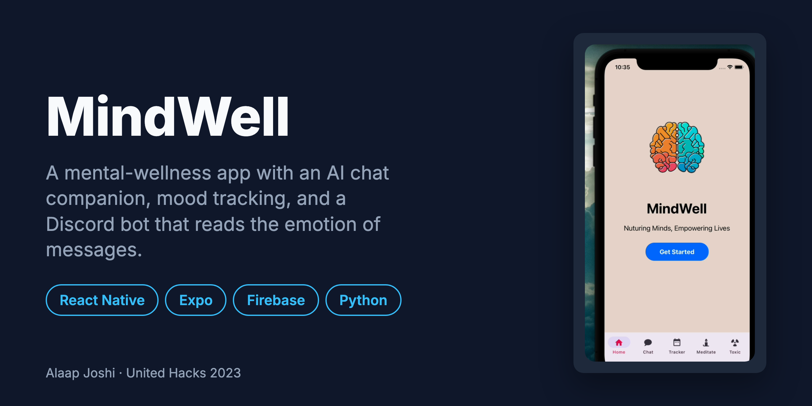
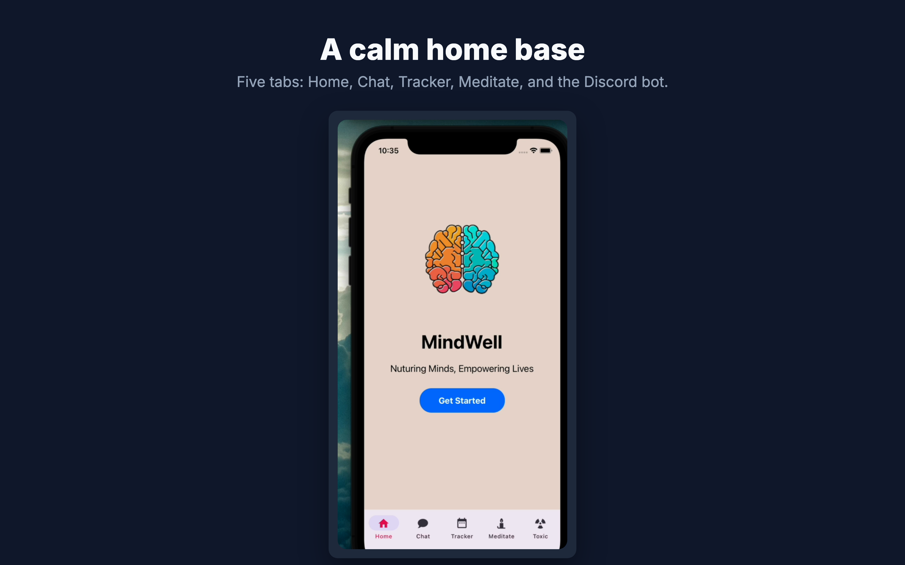
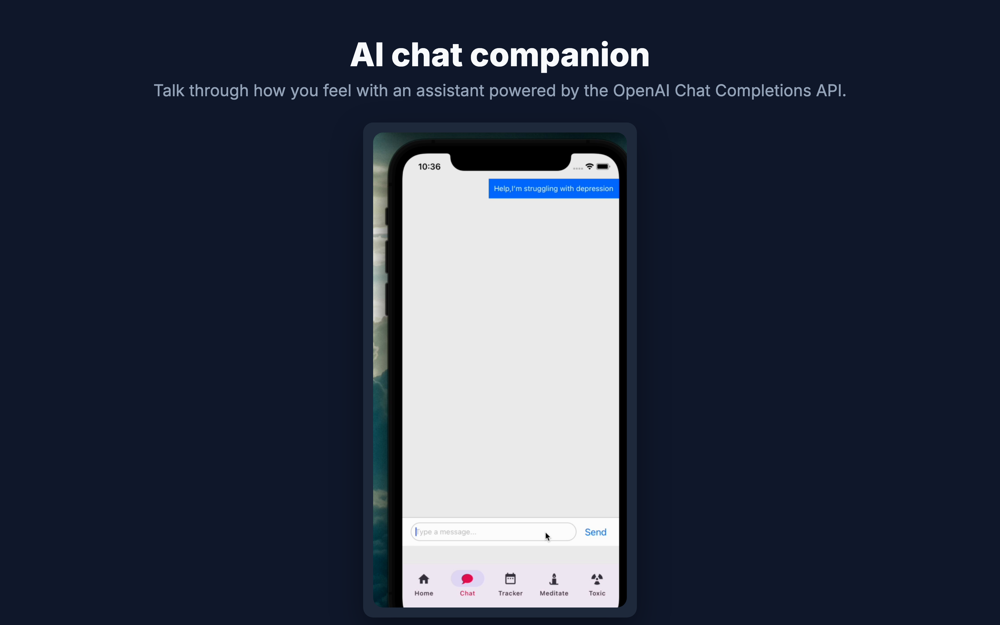
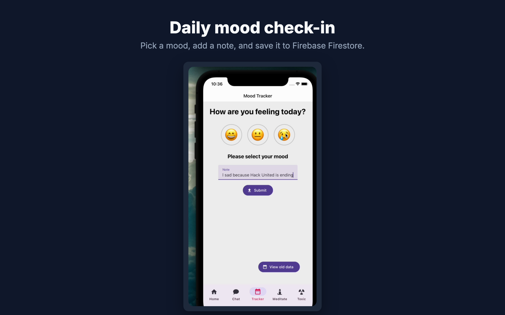
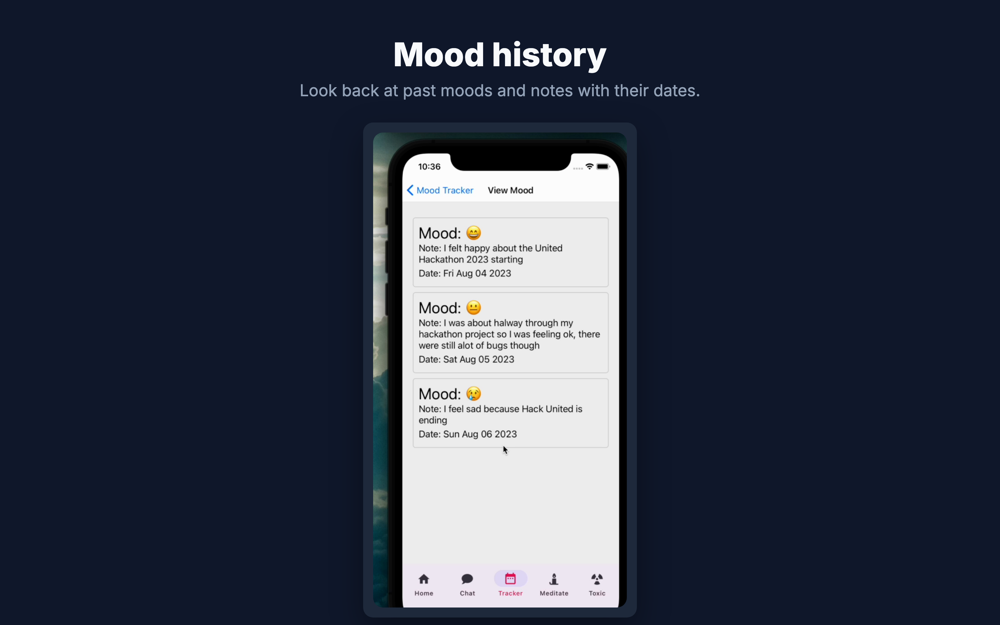
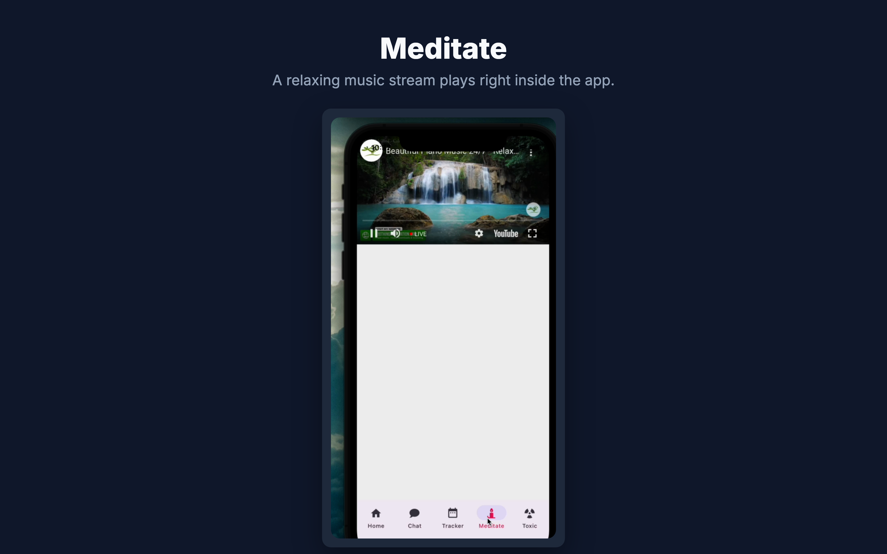
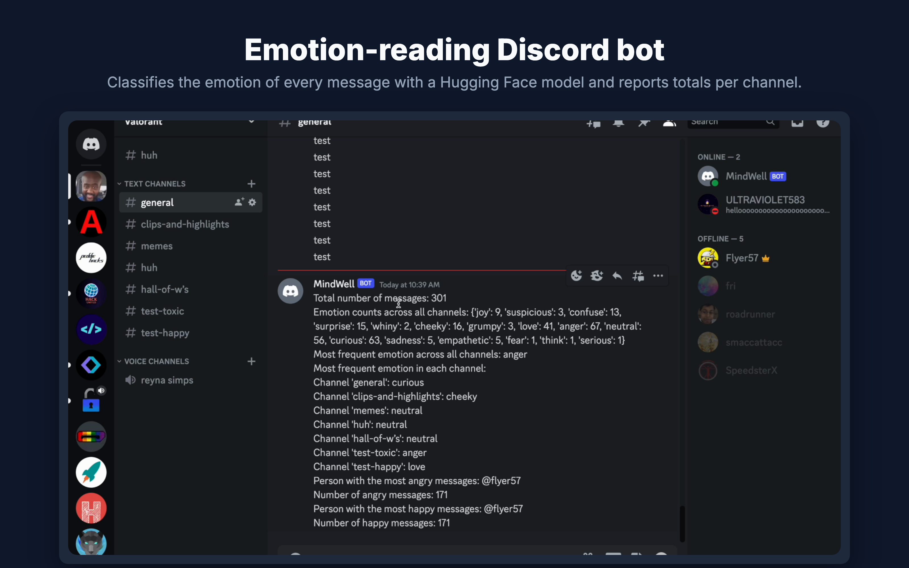

# MindWell

> A mental-wellness app with an AI chat companion and mood tracking, plus a Discord bot that reads the emotion of messages to help curb toxicity.

   

## About

Built solo at **United Hacks 2023**. MindWell gives people a few simple tools for checking in on their mental health: an AI companion to talk to, a daily mood log with notes, and a meditation screen. A companion Discord bot classifies the emotion of every message in a server with a Hugging Face model, then reports which channels and people skew angry or happy, so moderators can spot toxicity early.

## Features

- Chats with an AI companion through the OpenAI Chat Completions API (`gpt-3.5-turbo`).
- Logs a daily mood (happy, neutral, sad) with a note, saved to Firebase Firestore.
- Shows mood history with each entry's note and date.
- Plays a relaxing music stream on a built-in Meditate screen.
- Classifies the emotion of Discord messages with the `jitesh/emotion-english` model and reports totals per channel and per user.

## Gallery

<table>
  <tr>
    <td width="50%"> Home screen with tabs for Chat, Tracker, Meditate, and the Discord bot</td>
    <td width="50%"> AI chat companion</td>
  </tr>
  <tr>
    <td width="50%"> Daily mood check-in with a note</td>
    <td width="50%"> Mood history</td>
  </tr>
  <tr>
    <td width="50%"> Meditate screen</td>
    <td width="50%"> Discord bot's emotion report for a server</td>
  </tr>
</table>

## Tech Stack

| Layer | Technology |
|---|---|
| Mobile app | React Native 0.72, Expo SDK 49, React Navigation, React Native Paper |
| Database | Firebase Firestore |
| AI | OpenAI Chat Completions API (`gpt-3.5-turbo`), Hugging Face Transformers (`jitesh/emotion-english`) |
| Discord bot | Python, discord.py |

## Getting Started

### Prerequisites

- Node.js 18 and npm
- Python 3.9+ (for the Discord bot)
- An OpenAI API key, a Firebase project, and a Discord bot token

### Installation

~~~bash
git clone https://github.com/alaapjoshi/MindWell.git
cd MindWell
npm install
~~~

Add your own keys before running:

- OpenAI key: `apiKey` in `src/screens/Chat.jsx`
- Firebase config: the `firebaseConfig` values in `src/firebase.js`, `src/moodTrack/MoodTrackerPage.jsx`, and `src/moodTrack/ViewMoodPage.jsx`
- Discord bot token: `BOT_TOKEN` in `discord-bot/ai.py` and the files in `discord-bot/scripts/`

### Usage

Run the app:

~~~bash
npx expo start
~~~

Run the Discord bot:

~~~bash
cd discord-bot
pip install -r requirements.txt
python ai.py
~~~

The `scripts/` folder holds the pipeline that pulls server messages and builds the emotion report; `scripts/run.txt` lists the order to run them in.

## Project Structure

~~~text
MindWell/
  App.js            # tab navigation for the five screens
  src/screens/      # Home, Chat, Meditate, and the Discord bot intro screen
  src/moodTrack/    # mood check-in and mood history screens
  src/firebase.js   # Firebase setup
  discord-bot/      # emotion-classifying Discord bot and its report scripts
  assets/           # app icons, logo, and background
  docs/images/      # README cover and gallery images
~~~

## How It Works

~~~mermaid
flowchart LR
  User((User)) --> App[MindWell app]
  App -->|chat messages| OpenAI[OpenAI Chat API]
  App -->|mood + note| Firestore[(Firebase Firestore)]
  Discord[Discord server] -->|messages| Bot[Python bot]
  Bot -->|text| HF[Hugging Face emotion model]
  HF -->|emotion label| Bot
  Bot -->|emotion report| Discord
~~~

The app is a five-tab Expo app. Chat sends the conversation to the OpenAI API and shows the reply. The mood tracker writes each entry to Firestore and reads them back for the history view. The bot runs separately: it reads messages from a Discord server, labels each one with an emotion, and posts totals per channel and per user.

## Known Limitations

- Built in 2023 on Expo SDK 49. Current versions of the Expo Go app no longer open SDK 49 projects, so running it today needs an older Expo Go or an upgrade to a newer SDK.
- API keys are set directly in source files. A real release would load them from environment variables or a backend.

## Future Improvements

- Upgrade to a current Expo SDK and move API keys to environment variables.
- Add mood trends over time (weekly and monthly charts).
- Let server moderators trigger the bot's emotion report with a slash command.

## Author

**Alaap Joshi** - Computer Science + Cognitive Science, Rutgers University-New Brunswick
[GitHub](https://github.com/alaapjoshi) | [LinkedIn](https://linkedin.com/in/alaapjoshi)

## License

MIT. See [LICENSE](LICENSE).
